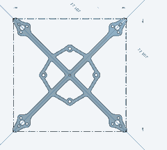
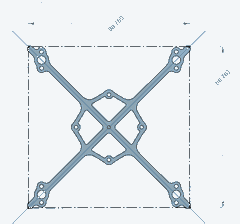
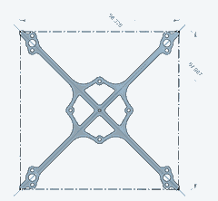
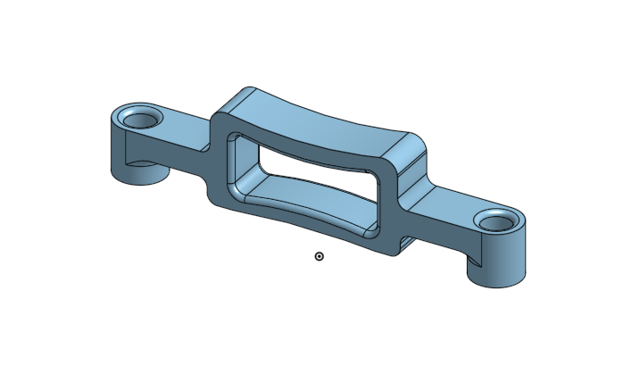

**Lightweight freestyle frames for 1S–2S FPV builds.**

[**Frames**](#frames) · [**Battery holder**](#1s-battery-holder) · [**License**](#license)

---

## About

**Lightweight, strong and made for freestyle.** LS-FRAMES use intentionally thin arms to put less material directly beneath the propellers. This reduces obstruction of the propeller airflow, with the aim of improving efficiency, flight time and performance.

All three designs accommodate the **BETAFPV Matrix 1S 5IN1 II**, including clearance for its **plug-in motor connectors**.

## Frames

| **LS92 V2** | **LS105 V2** | **LS118 V2** |
|:---:|:---:|:---:|
|  |  |  |
| **2"** | **2.5"** | **3"** |
| 2.5 mm carbon | 2.5 / 3 mm carbon | 2.5 / 3 mm carbon |
| 1S–2S | 1S–2S | 1S–2S |
| **[Download DXF](frames/LS92/cad/LS92%20V2%20%282.5mm%29.dxf)** | **[Download DXF](frames/LS105/cad/LS105%20V2%20%283mm%29.dxf)** | **[Download DXF](frames/LS118/cad/LS118%20V2%20%283mm%29.dxf)** |

> **Cutting note:** LS105 and LS118 DXF names specify 3 mm, but either can also be cut from 2.5 mm carbon. Check scale and hardware fit before manufacturing.

## 1S Battery Holder

3D-printable battery holder for **BETAFPV LAVA 480, 580 and 680 mAh 1S batteries**, designed for the **LS92 V2, LS105 V2 and LS118 V2** frames.

**[Download STL](accessories/1S-LAVA-battery-holder/LAVA-1S-480-580-680-battery-holder.stl)**

## License

Frame **DXF** and battery-holder **STL** files are available under the **[CERN-OHL-S-2.0](LICENSE)** open-hardware license, including its conditions for sharing modified designs.

The **LS-FRAMES name and logo are reserved** and are not covered by that license. See [NOTICE.md](NOTICE.md) for details.
